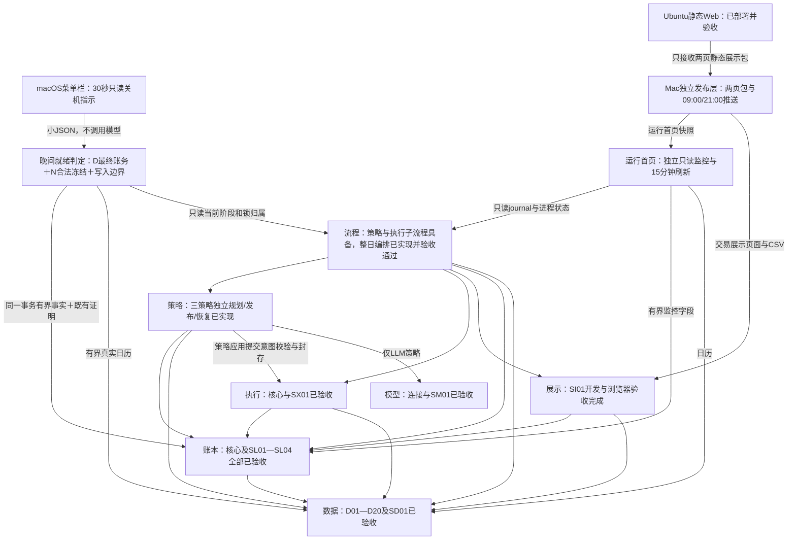

# 当前实施状态与续接入口

更新日期：**2026-11-10，北京时间**。唯一运行根为当前 `simulate-china-stocks`；[机器入口](../logs/project-current-state.json)记录同一状态与发生时证据。现行方案、源码、配置和入口均原位维护；历史金融原件、恢复点、封口验收是有效证据，不是旧运行版本。

**本轮三项耗时优化及全项目整理已完成（WP01—WP16）**。先建立[唯一方案](strategy-performance-design.txt)并独立审查，再实施、自测、互审、部署和实际核验，最后整理全项目文件与说明。[最终验收](../logs/workflow-performance-2026-11-10-final-acceptance.json)逐项列出方案对应实现与证据，无本轮需求遗漏。此前SP01—SP12的新计划及冻结恢复能力继续保留。

| 本轮优化 | 固定隔离输入的改前→改后耗时 | 核验边界 |
|---|---|---|
| 大型证据一次序列化、PROPOSED小回执与冻结静态投影 | 三户新计划118.89→97.43秒，减少18.1% | 100只证券/121历史交易日，经济语义摘要一致；改前/改后均仅LLM调用受控模型1次 |
| 同次数据更新内按完整依赖守卫复用原件核验 | 零请求检查4.77→2.54秒，减少46.7% | 原件JSON读取16639→908次；每唯一来源归一化、事实与查询结果保持 |
| 同轮账单输入复核复用与窄状态查询 | 推进时钟场景冷轮1.38→0.91秒、热轮1.29→0.85秒，减少约34% | 新鲜指纹1380次保持；events/coverage按精确cutoff重查、不写瞬时持久回执 |

详见[性能报告](../logs/workflow-performance-2026-11-10-performance-report.html)。各项为不同隔离场景，不能相加或换算成整晚节省；市场缓存基准的进程生命周期峰值RSS增加约9.2MB，编码缓存限额不等于进程内存硬上限。首次、旧格式或证明失效仍须完整核验。

**开发与部署验证**：全量测试初次3602项通过，39项因macOS沙箱的进程/Swift缓存权限失败或报错；仅对受影响范围在具备宿主权限后复验52项，通过后按唯一节点归并为**3641项全部通过**，未改代码掩盖环境错误。Ruff及实际worktree敏感信息扫描通过。三户经公开接口追加同参数维护政策，revision 5、**11月11日生效**；金融revision、原参数/资金/持仓/订单/模型尝试保持。原业务任务已按原Label、日程、配置恢复加载启用；首页、上传、菜单栏保留原安装。源码改变，基线内9份项目配置摘要保持；命令1/2不变，既有数据不重下；上述性能维护阶段无额外云端发布，也未暂存、提交或推送Git。后续按用户授权进行的公开Git审查与推送，另见[审查记录](../logs/git-push-2026-11-10-review.json)和[发布回执](../logs/git-push-2026-11-10-receipt.json)，以各自发生时状态为准。

**全项目整理**：完整元数据盘点59883项，其中56379个普通文件、3500个目录、4个链接，0扫描错误；不跟随链接。按新鲜身份与独立审查清除26处可再生缓存/Finder元数据：332个文件、22个目录，逻辑字节10,358,056（约10.36MB，不声称物理释放空间）。324份保留源码/配置/测试/脚本摘要一致；清理后原3264个证据文件再次逐个核验保持。常驻程序随后重建的字节码均对应当前源码，属于正常运行产物，不反复删除。 当前分层说明按唯一职责归纳，修正旧“当前”时点、SG延期/后续授权时间线、ER证明生成契约及重复段；原字节先封存，封口历史不改写。全部业务资料、有效备份、本机发布层、环境与Git历史保留。详见[盘点](../logs/workflow-performance-2026-11-10-project-inventory.json)、[清理回执](../logs/workflow-performance-2026-11-10-cleanup-result.json)、[文档核验](../logs/workflow-performance-2026-11-10-documentation-validation.json)。

## 当前能力与运行规则

| 层 | 已具备并完成相应验收的能力 | 唯一详细契约 |
|---|---|---|
| 数据 `market` | D01—D20、SD01；候选池、日历、行情、权益、指数、增量恢复、按用途读取、证据与自定义窗口。SC分类修正和受控重建已完成；真实冲突与来源缺项按用途隔离 | [数据清单](data-layer-backlog.md)、[操作与API](first-preparation.md) |
| 账本 `ledger` | L01—L24、LX01—LX05、SL01—SL04；同一21表schema4，独立账户、资金持仓、权益税、连续日结、权威政策/决策、备份与恢复 | [账本方案](ledger-design.txt) |
| 规则执行 `execution` | 盘前完整验证、开盘价参考撮合、冻结证据贯通、原单恢复；纯计算与显式freeze/settle分开 | [执行方案](execution-design.txt) |
| 策略 `strategies/application` | S1、S1-LT、LLM-Daily独立inspect/evaluate/plan/publish/recover/audit；五交易日父任务、模型持久尝试和审计 | [策略方案](strategy-design.txt) |
| 独立模型 `models` | 可替换兼容接口、配置、SM01脱敏与安全审计；真实连接与策略调用分别留证 | [模型说明](model-layer.md) |
| 流程/调度 `application/scheduler` | WF整日编排、月末换池、恢复、锁、预算、journal；CR连续日结及复用；CW日历触发 | [工作流](workflow-design.txt) |
| 展示 `reporting` | 首页及交易看板；中文状态、计划/成交/行情、历史个股损益随日期切换、含费均价/批次、完整买卖/清仓汇总、CSV及独立审计 | [界面方案](interface-design.txt) |
| 独立发布 `publishing`（本机附加层） | 两页必要静态包，Mac09:00/21:00推送、漏槽只补最近一次、同槽去重、失败保旧；Ubuntu纯静态Web | [发布方案](publishing-schedule-design.txt) |
| 关机提示 `readiness/desktop` | ER只读D/N判定、有效证明/写入边界、原生菜单栏及登录项；不调用模型或采集 | [关机就绪](evening-readiness-design.txt) |
| 存储/运行记录 | SG紧凑索引、CAS证据、受控迁移清理；RO分调用阶段/资源/异常堆栈、归档与受保护留存 | [存储治理](storage-runtime-governance-design.txt)、[运行观测](runtime-observability-design.txt) |

S1、S1-LT、LLM三个正式账户均沿用既有激活、唯一注资、政策、成交、持仓和审计；不需要因整理或补办重开账户。仅LLM每日最多5个买卖代码；两个规则策略无此截断，其余现金、持仓席位、目标及交易规则继续约束。S1-LT在相同评分之外采用保留排名和减仓阈值，特定日期与S1产生相同订单是允许的。

原三个任务现行使用每小时**00/15/30/45分**的`StartCalendarInterval`并保留`RunAtLoad`，业务额外18:10。17:00（含）—19:00（不含）跳过自动业务；19:00后续办到期工作。睡眠跨过定时点后唤醒合并检查一次，不回放错过的tick；短睡未跨点或仅解锁不保证立即启动。同Label在途进程继续原轮，不并行或强杀，结束后等后续正常刻度。`next_check_at`是计划时点，不是准点保证。

晚间依次处理到期数据、旧到新账务及原冻结订单、最终日结，再冻结下一真实交易日计划；目标日09:00截止后不能补造历史策略。已经冻结的计划不会重新规划，已有计划可以延后结算。合法空计划有效；缺数据按用途等待，不使无关股票/账户全部停止。每日默认20交易日/3600秒阶段预算、来源冷却和模型首次硬截止保持。

菜单栏绿灯要求三户D日账务与最终估值连续、N合法计划已冻结、必要义务无未决、无相关财务写入；不依赖首页/云端上传，也不保证订单必然成交。它是额外一个轻量只读常驻显示进程，与原三个按次任务独立。

## 最近已核运行与验收边界

**11月10日16:03:40—16:43:09**，原业务任务的首轮自然调用为COMPLETE、退出0，耗时39分29秒，无事件丢失、预算未耗尽。数据阶段112.99秒，8次来源请求均成功；report.render为1327.48秒（约22分7秒），backup.write为811.71秒（约13分32秒），外层日报与备份合计占整轮90.42%。三户plan阶段恢复既有11月10日冻结计划，合计23.03秒；9次workflow.recovery另合计48.56秒，未调用模型或生成未来11月11日新计划。新备份只读公开核验一次为READY，包含3270个证据文件。16:55:56安装状态复核：原业务/首页任务空闲且最近退出0，原三任务及菜单栏均安装、加载、启用并与配置匹配；该快照不代替读取时的实时状态。

该轮是本次验证器更新后的首次自然调用，阶段耗时按实测单列；日志没有内部冷核计数，不能把全部报告耗时归因为冷核。它验证当前部署及既有业务恢复，不替代今晚未来新计划的同输入前后对照。完整记录见[自然调用](../logs/workflow-performance-2026-11-10-natural-run.json)与[保护核验](../logs/workflow-performance-2026-11-10-final-protection.json)。原3264个编码证据文件、约1.94GB逐个SHA保持，新增政策和自然采集另按发生时记录。

此前CW的隔离launchd探针证明运行中不并发、退出后不补跑已错过刻度；未因此宣称本机物理睡眠/重启实测。ER菜单可见及内容由用户确认，TH/SI01浏览器验收仍以各日期回执的操作人和范围为准，本轮没有增加浏览器或云端验收。云端继续使用本机附加发布层与Ubuntu纯静态页面；实际连接配置仅留本机。账户金额、成交、覆盖和页面新鲜度应读取对应现行报告或公开查询，历史计数不作为今日快照。

## 尚未解决的事项

1. **LLM等待输入记录的跨轮安全复用**：仍需逐值证明输入语义相同；本次同轮账单复核缓存不等于可跳过新WAITING_INPUT记录。
2. **新备份的历史证据闭包、解析及哈希成本**：保持原备份格式、完整恢复证据和留存算法，尚未实施增量闭包优化。
3. **首次或验证器变化后的完整核验与报告重建**：热证明可复用，但冷核不能删减；本次实际报告耗时另记，不宣称消除所有长阶段。
4. **真实采集网络等待**：本次减少本地重复原件读取；连接/会话复用仍需分段测量，不改变原请求、重试、冷却、18:10新鲜度与晚到修订规则。

真实来源冲突、未披露税基及其他缺证仍按用途隔离或等待。11月9日晚20:30三户已冻结但整轮PARTIAL的历史事实保留在[晚间诊断](../logs/workflow-night-2026-11-10-review.json)，不能把PARTIAL直接解释成无交易计划。

## 命令与资料入口

命令1 `prepare-data` 用于首次/月末选池；命令2 `data-sync` 用于日常补缺。月末顺序为D旧池命令2 → 命令1 → 明确新池代码补缺，新池下一交易日生效。已有合格历史复用，不因本轮整理重新下载。

[README](../README.md)集中保留环境、账户、数据、工作流、策略、账本、模型、日志、发布和受控维护命令。只读查询包括doctor/status、workflow-inspect、scheduler-status、dashboard-service-status、dashboard-sync-status及shutdown-status；`workflow-run`即使不下载也可能写账务/调用策略，不能用于只读核查。维护安装/上传不隐式改变账户政策或重新激活。

## 分层依赖关系

图示本机完整环境；发布与云端部署只留本机，公开Git不包含这些附加实现。箭头从使用方指向能力提供方。现行workflow组织这些公开调用，是否实际运行由激活状态、开关和就绪条件决定。

执行层接收策略意图或账本冻结计划，不直接重新调用策略；撮合只计算结果，账本是账户事实的唯一写入方。数据层不依赖其他业务层，账本不反向导入策略/执行/模型实现。

## 当前入口与封口证据

- [本文件](implementation-status.md)：当前能力、已核范围与未解决事项；[机器状态](../logs/project-current-state.json)是可更新派生快照。
- [总架构](architecture.txt)及各层附件：唯一现行契约；[目录说明](data-layout.md)定义文件用途、保护及整理规则。
- [建设决策与验收索引](architecture-change-log.md)：按日期定位完整回执。封口JSON、金融原件和审计证据不改写成今天；它们是追溯/恢复资料，不是另一套运行方案。
- 修改已被历史SHA引用的当前文件前，保存原字节到`data/normalized/project-audit-evidence/<sha>.evidence`；通过audit_archive解析raw/压缩wrapper，不能覆盖既有wrapper或猜测其内容。
- 只执行当前改动所需验证并保存实际范围；文档整理不重复全项目测试，不把测试数量累计混成最新一次结果。安装状态、业务完成和浏览器验收分别记录。

| 能力/事项 | 最新相关封口入口 | 范围 |
|---|---|---|
| WP三项耗时优化与全项目整理 | [11月10日验收](../logs/workflow-performance-2026-11-10-final-acceptance.json)、[性能报告](../logs/workflow-performance-2026-11-10-performance-report.html) | WP01—WP16逐项核对，3641唯一测试通过；自然运行、保护、文档与清理分别留证 |
| SP新计划与冻结恢复 | [11月9日验收](../logs/strategy-performance-2026-11-09-final-acceptance.json) | 404唯一测试、同参数未来维护及首轮实际运行；首次冷核与热路分开 |
| 晚间耗时诊断 | [11月10日报告](../logs/workflow-night-2026-11-10-report.html)、[11月3日至9日报告](../logs/workflow-performance-2026-11-09-report.html) | 仅对应观察窗口的日志事实，不作为改后整晚收益 |
| 模型连接维护 | [11月6日脱敏回执](../logs/model-connection-maintenance-2026-11-06.json) | 当次公开配置与冻结输入一致，JSON连接约2.75秒；不推断服务端模型完全相同 |
| CI平台契约及公开Git | [平台契约验收](../logs/github-ci-repair-2026-11-05-final-acceptance.json)、[11月10日审查](../logs/git-push-2026-11-10-review.json)、[11月10日发布回执](../logs/git-push-2026-11-10-receipt.json) | 本机性能维护与公开Git发布分别验收；提交、远端及CI状态按发布回执记录 |
| LP独立发布与Git边界 | [11月5日验收](../logs/local-publishing-boundary-2026-11-05-final-acceptance.json) | 发布层及全部专用程序/配置本机保留；双安装状态核验、任务匹配；未提交/推送 |
| GP公开仓库准备（先前范围） | [11月5日验收](../logs/git-push-preflight-2026-11-05-final-acceptance.json) | 实际候选内容与忽略边界、65项必要验证、公开说明脱敏；未提交/推送，业务不变 |
| DO目录归纳与清理 | [11月5日验收](../logs/directory-consolidation-2026-11-05-final-acceptance.json)、[文档核验](../logs/directory-consolidation-2026-11-05-documentation-validation.json) | DO阶段78项根路径可撤销移除，后续精确清除另记；315项程序/配置身份保护，282条文档引用检查及3处定点修正；不重复业务测试 |
| CW日历触发 | [11月5日验收](../logs/calendar-wake-2026-11-05-final-acceptance.json) | 148项必要测试、三个任务重装及首轮实际结果；无物理睡眠测试 |
| ER关机指示 | [11月4日验收](../logs/evening-readiness-2026-11-04-final-acceptance.json) | 156项最新唯一节点；用户原生菜单确认 |
| TH历史损益/成本/交易历史 | [11月4日验收](../logs/trading-history-2026-11-04-final-acceptance.json) | 270项必要验证、本机/云端更新及明确浏览器范围 |
| TU交易页 | [11月4日验收](../logs/trading-dashboard-2026-11-04-final-acceptance.json) | 中文与重点信息布局、只读损益投影 |
| CR连续日结/复用 | [11月3日验收](../logs/continuity-repair-2026-11-03-final-acceptance.json) | 同义日结、权益适用性、跨轮及备份复用；537唯一节点 |
| SG存储治理 | [11月3日验收](../logs/storage-governance-2026-11-03-final-acceptance.json) | schema4迁移、证据保真、监督恢复和受控清理；性能未决另列 |
| 真实晚间业务 | [11月3日闭环](../logs/evening-acceptance-2026-11-03-final-acceptance.json) | 当日数据/无计划日结及次日计划；业务完成不等于全部性能完成 |
| 发布、任务命名、运行观测 | [日期索引](architecture-change-log.md) | 各次配置、安装、上传、UI和日志范围独立保留 |
| 三策略/WF/正式启用 | [三策略](../logs/strategy-implementation-2026-11-01-final-acceptance.json)、[WF](../logs/workflow-implementation-2026-11-01-final-acceptance.json)、[正式启用](../logs/production-start-2026-11-01-final-receipt.json) | 建设验收、生产激活与真实周期分别记录 |
| 数据/账本/执行及早期UI | [分层决策索引](architecture-change-log.md) | 原日期逐项矩阵、真实采集、迁移和浏览器证据 |
