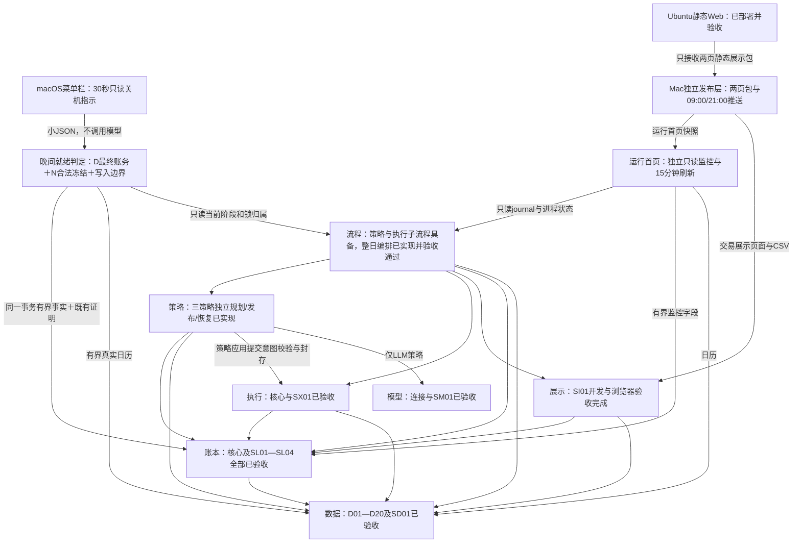

# 当前实施状态与续接入口

更新日期：**2026-11-05，北京时间**。唯一运行项目为当前 `simulate-china-stocks` 目录；[机器当前入口](../logs/project-current-state.json)保存同一状态及发生时证据指针。

**GitHub CI 平台契约修复**：首次公开提交的Ubuntu全量检查为3217通过、36按平台/可选层跳过、1失败；唯一失败来自菜单栏安装状态测试错误要求所有系统返回macOS成功结果。现已显式覆盖Darwin的`BUILD_REQUIRED/0`与Linux的`UNSUPPORTED_PLATFORM/2`，两者保留只读、无构建/安装断言；本机相关12项测试及Ruff通过。生产源码和Git排除规则不变，后台任务无需重装；CI新增最慢20项耗时输出，完整检查范围不减。对应提交的远端最终结果以[GitHub Actions](https://github.com/zifeng-yu/simulate-china-stocks/actions)及本机`logs/github-ci-repair-2026-11-05-final-acceptance.json`为准。

**独立发布层与Git边界调整已完成（LP01—LP06）**：唯一`publishing/`层及其全部配置/模板、Web部署目录、上传启动器和专用云端测试只留本机，不提交公开仓库；核心CLI和首页通过可选接口接入，公开克隆缺该层仍可运行，已安装组件损坏则明确报错/未知。实际上传实现和配置未改变。必要安全检查60项通过；本机可选接入和混合专项117项通过；真实公开候选副本108项通过、7项云端节点按预期跳过，3254项可收集，Ruff通过。未重复全套测试。详见[LP验收](../logs/local-publishing-boundary-2026-11-05-final-acceptance.json)。

**本机部署核验：11月5日11:48**，原三个任务均安装、加载、启用且当前渲染匹配；菜单栏仍运行。安装文件摘要保持，现用源码路径在每次启动时加载最新接入代码，无需卸载重装；本次没有远端页面或数据变化。命令1/2、既有数据和账户规则不变，不需重新下载。上述LP验收时未暂存、提交或推送；其后已获用户明确授权，按实际核验清单执行公开Git发布。当前提交以Git历史和远程main为准，发布回执保存在本机`logs/git-public-push-2026-11-05-final-receipt.json`；远端CI状态以实际运行结果为准。

先前[GP公开仓库核验](../logs/git-push-preflight-2026-11-05-final-acceptance.json)保留其发生时扫描和脱敏结果；当前提交范围以上述LP边界为准。原性能未决事项仍保留。

**废纸篓后续**：用户自行清理后，Finder曾阻止删除退役`runs`；本轮在用户明确限定授权下核对原目录身份，以不跟随符号链接的文件系统操作删除该目录，耗时约6.2秒。其他废纸篓内容未处理，主项目抽查原配置/源码摘要保持。[精确删除回执](../logs/git-push-preflight-2026-11-05-trash-permanent-delete.json)记录不可撤销的实际操作。下段“移入废纸篓”描述先前整理动作，不再表示该`runs`仍可恢复。

**此前目录归纳与清理已完成（DO01—DO10）**：`/量化A股`外层只保留`simulate-china-stocks`。31项外层退役材料与47项主项目可再生缓存或Finder元数据当时按核验清单原子移入系统废纸篓；DO阶段仅可撤销移除，后续清除状态见上段，不据移动动作推算释放空间。外层没有发现主项目欠缺的独有有效材料，因此没有机械迁入旧实现或旧数据。现行方案见[目录与清理边界](data-layout.md)，实际处置见[清理回执](../logs/directory-consolidation-2026-11-05-cleanup-result.json)。

README已归纳为完整操作指南，保留原45个shell示例命令名；本文件收敛当前能力和已核范围；架构调整记录保留53项早期决策及近期事项的日期/边界/回执索引。6份附件删除重复的历史验收长段，16份分层文档继续各有唯一职责；原说明字节按原SHA归档，金融事实、来源、冻结证据、CAS与恢复点引用保持。此次没有扩展性能优化。

[整理后运行环境核验](../logs/directory-consolidation-2026-11-05-runtime-verification.json)确认315项源码/配置/测试/元数据摘要及三策略身份保持，命令帮助成功、导入来自项目自身环境；三个任务安装/启用/配置匹配、当次空闲且最近退出0，菜单栏仍运行。DO阶段程序和公开页面未改变；本轮接入变化与部署结论以上方LP核验为准。

## 当前能力与运行规则

| 层 | 已具备并完成相应验收的能力 | 唯一详细契约 |
|---|---|---|
| 数据 `market` | D01—D20、SD01；候选池、日历、行情、权益、指数、增量恢复、按用途读取、证据与自定义窗口。SC分类修正和受控重建已完成；真实冲突与来源缺项按用途隔离 | [数据清单](data-layer-backlog.md)、[操作与API](first-preparation.md) |
| 账本 `ledger` | L01—L24、LX01—LX05、SL01—SL04；同一21表schema4，独立账户、资金持仓、权益税、连续日结、权威政策/决策、备份与恢复 | [账本方案](ledger-design.txt) |
| 规则执行 `execution` | 盘前完整验证、开盘价参考撮合、冻结证据贯通、原单恢复；纯计算与显式freeze/settle分开 | [执行方案](execution-design.txt) |
| 策略 `strategies/application` | S1、S1-LT、LLM-Daily独立inspect/evaluate/plan/publish/recover/audit；五交易日父任务、模型持久尝试和审计 | [策略方案](strategy-design.txt) |
| 独立模型 `models` | 可替换兼容接口、配置、SM01脱敏与安全审计；真实连接与策略调用分别留证 | [模型说明](model-layer.md) |
| 流程/调度 `application/scheduler` | WF整日编排、月末换池、恢复、锁、预算、journal；CR连续日结及复用；CW日历触发 | [工作流](workflow-design.txt) |
| 展示 `reporting` | 首页及交易看板；中文状态、计划/成交/行情、历史个股损益随日期切换、含费均价/批次、完整买卖/清仓汇总、CSV及独立审计 | [界面方案](interface-design.txt) |
| 独立发布 `publishing`（本机附加层） | 两页必要静态包，Mac09:00/21:00推送、漏槽只补最近一次、同槽去重、失败保旧；Ubuntu纯静态Web | [发布方案](publishing-schedule-design.txt) |
| 关机提示 `readiness/desktop` | ER只读D/N判定、有效证明/写入边界、原生菜单栏及登录项；不调用模型或采集 | [关机就绪](evening-readiness-design.txt) |
| 存储/运行记录 | SG紧凑索引、CAS证据、受控迁移清理；RO分调用阶段/资源/异常堆栈、归档与受保护留存 | [存储治理](storage-runtime-governance-design.txt)、[运行观测](runtime-observability-design.txt) |

S1、S1-LT、LLM三个正式账户均沿用既有激活、唯一注资、政策、成交、持仓和审计；不需要因整理或补办重开账户。仅LLM每日最多5个买卖代码；两个规则策略无此截断，其余现金、持仓席位、目标及交易规则继续约束。S1-LT在相同评分之外采用保留排名和减仓阈值，特定日期与S1产生相同订单是允许的。

原三个任务现行使用每小时**00/15/30/45分**的`StartCalendarInterval`并保留`RunAtLoad`，业务额外18:10。17:00（含）—19:00（不含）跳过自动业务；19:00后续办到期工作。睡眠跨过定时点后唤醒合并检查一次，不回放错过的tick；短睡未跨点或仅解锁不保证立即启动。同Label在途进程继续原轮，不并行或强杀，结束后等后续正常刻度。`next_check_at`是计划时点，不是准点保证。

晚间依次处理到期数据、旧到新账务及原冻结订单、最终日结，再冻结下一真实交易日计划；目标日09:00截止后不能补造历史策略。已经冻结的计划不会重新规划，已有计划可以延后结算。合法空计划有效；缺数据按用途等待，不使无关股票/账户全部停止。每日默认20交易日/3600秒阶段预算、来源冷却和模型首次硬截止保持。

菜单栏绿灯要求三户D日账务与最终估值连续、N合法计划已冻结、必要义务无未决、无相关财务写入；不依赖首页/云端上传，也不保证订单必然成交。它是额外一个轻量只读常驻显示进程，与原三个按次任务独立。

## 最近已核运行与验收边界

公开仓库准备前的只读核验记录**2026-11-05 11:02**：最近自然业务11:00:04—11:01:37，COMPLETE；三个任务当时均空闲、最近退出0，菜单栏运行。详见[运行核验](../logs/git-push-preflight-2026-11-05-runtime-check.json)。此前CW的10:21维护事实继续保留如下。详细时点及源码见[CW实际运行](../logs/calendar-wake-2026-11-05-runtime-verification.json)：

- 原三个Label于10:19重新安装启用；加载、启用、配置匹配均通过。
- 业务首轮约119.94秒，COMPLETE、退出0、预算未耗尽；该次业务上下文D为11月4日、N为11月5日。
- 首页约2.07秒成功发布，下一计划检查时间为10:30。上传约0.42秒结束0，复用已成功09:00槽，changed=false；下次正常上传槽21:00。
- 三个任务在该观察时点均空闲、最近退出0；菜单栏程序RUNNING。此快照不是本文件读取时的实时进程状态。

CW必要测试一轮148项通过、Ruff通过；隔离真实launchd探针证明运行中跨日历时点不并发、退出后不补跑该tick。没有为此让本机物理睡眠或重启，不能把隔离探针称为睡眠实测。之前ER菜单可见及内容由用户确认，CUA对无窗口应用的失败边界保留；TH交易历史交互的浏览器范围见其日期化回执，不扩大为额外手机/全场景验收。

云端使用Ubuntu、Nginx纯静态展示，首页路径`/index.html`、交易看板`/trading.html`；实际连接配置和访问地址只保留在本机发布配置及忽略的机器状态入口中，具体部署说明`deploy/web/README.txt`仅留本机，不随Git提供。CW时已知最近成功上传为11月5日09:57；本轮没有宣称10:21业务结果已经上传。当前账户金额、成交、市场覆盖和页面数据应读取相应现行报告/公开查询，不把早期100股、99/97/80用途计数或Nov3账单当作今日快照。

## 尚未解决的事项

1. **已冻结计划恢复仍有完整原件展开热点**。11月3日晚间实测发现较高读取/CPU开销；此前终态快路、日结去重及显示优化不等于此热点已解决。
2. **LLM等待输入记录的安全复用仍待评估**。早期多轮会推进报告/备份链，尚未逐值证明全部输入语义相同，不能直接删除记录或一概称为冗余。

[原运行复审](../logs/evening-acceptance-2026-11-03-runtime-review.json)及[边界补充](../logs/evening-acceptance-2026-11-03-runtime-review-clarification.json)保留上述证据。本轮目录整理不实施这两项性能优化；真实来源冲突、未披露税基及其他缺证仍按现有规则隔离/等待，不以清理消除。

## 命令与资料入口

命令1 `prepare-data` 用于首次/月末选池；命令2 `data-sync` 用于日常补缺。月末顺序为D旧池命令2 → 命令1 → 明确新池代码补缺，新池下一交易日生效。已有合格历史复用，不因本轮整理重新下载。

[README](../README.md)集中保留环境、账户、数据、工作流、策略、账本、模型、日志、发布和受控维护命令。只读查询包括doctor/status、workflow-inspect、scheduler-status、dashboard-service-status、dashboard-sync-status及shutdown-status；`workflow-run`即使不下载也可能写账务/调用策略，不能用于只读核查。维护安装/上传不隐式改变账户政策或重新激活。

## 分层依赖关系

图示本机完整环境；发布与云端部署只留本机，公开Git不包含这些附加实现。箭头从使用方指向能力提供方。现行workflow组织这些公开调用，是否实际运行由激活状态、开关和就绪条件决定。

执行层接收策略意图或账本冻结计划，不直接重新调用策略；撮合只计算结果，账本是账户事实的唯一写入方。数据层不依赖其他业务层，账本不反向导入策略/执行/模型实现。

## 当前入口与封口证据

- [本文件](implementation-status.md)：当前能力、已核范围与未解决事项；[机器状态](../logs/project-current-state.json)是可更新派生快照。
- [总架构](architecture.txt)及各层附件：唯一现行契约；[目录说明](data-layout.md)定义文件用途、保护及整理规则。
- [建设决策与验收索引](architecture-change-log.md)：按日期定位完整回执。封口JSON、金融原件和审计证据不改写成今天；它们是追溯/恢复资料，不是另一套运行方案。
- 修改已被历史SHA引用的当前文件前，保存原字节到`data/normalized/project-audit-evidence/<sha>.evidence`；通过audit_archive解析raw/压缩wrapper，不能覆盖既有wrapper或猜测其内容。
- 只执行当前改动所需验证并保存实际范围；文档整理不重复全项目测试，不把测试数量累计混成最新一次结果。安装状态、业务完成和浏览器验收分别记录。

| 能力/事项 | 最新相关封口入口 | 范围 |
|---|---|---|
| LP独立发布与Git边界 | [11月5日验收](../logs/local-publishing-boundary-2026-11-05-final-acceptance.json) | 发布层及全部专用程序/配置本机保留；双安装状态核验、任务匹配；未提交/推送 |
| GP公开仓库准备（先前范围） | [11月5日验收](../logs/git-push-preflight-2026-11-05-final-acceptance.json) | 实际候选内容与忽略边界、65项必要验证、公开说明脱敏；未提交/推送，业务不变 |
| DO目录归纳与清理 | [11月5日验收](../logs/directory-consolidation-2026-11-05-final-acceptance.json)、[文档核验](../logs/directory-consolidation-2026-11-05-documentation-validation.json) | DO阶段78项根路径可撤销移除，后续精确清除另记；315项程序/配置身份保护，282条文档引用检查及3处定点修正；不重复业务测试 |
| CW日历触发 | [11月5日验收](../logs/calendar-wake-2026-11-05-final-acceptance.json) | 148项必要测试、三个任务重装及首轮实际结果；无物理睡眠测试 |
| ER关机指示 | [11月4日验收](../logs/evening-readiness-2026-11-04-final-acceptance.json) | 156项最新唯一节点；用户原生菜单确认 |
| TH历史损益/成本/交易历史 | [11月4日验收](../logs/trading-history-2026-11-04-final-acceptance.json) | 270项必要验证、本机/云端更新及明确浏览器范围 |
| TU交易页 | [11月4日验收](../logs/trading-dashboard-2026-11-04-final-acceptance.json) | 中文与重点信息布局、只读损益投影 |
| CR连续日结/复用 | [11月3日验收](../logs/continuity-repair-2026-11-03-final-acceptance.json) | 同义日结、权益适用性、跨轮及备份复用；537唯一节点 |
| SG存储治理 | [11月3日验收](../logs/storage-governance-2026-11-03-final-acceptance.json) | schema4迁移、证据保真、监督恢复和受控清理；性能未决另列 |
| 真实晚间业务 | [11月3日闭环](../logs/evening-acceptance-2026-11-03-final-acceptance.json) | 当日数据/无计划日结及次日计划；业务完成不等于全部性能完成 |
| 发布、任务命名、运行观测 | [日期索引](architecture-change-log.md) | 各次配置、安装、上传、UI和日志范围独立保留 |
| 三策略/WF/正式启用 | [三策略](../logs/strategy-implementation-2026-11-01-final-acceptance.json)、[WF](../logs/workflow-implementation-2026-11-01-final-acceptance.json)、[正式启用](../logs/production-start-2026-11-01-final-receipt.json) | 建设验收、生产激活与真实周期分别记录 |
| 数据/账本/执行及早期UI | [分层决策索引](architecture-change-log.md) | 原日期逐项矩阵、真实采集、迁移和浏览器证据 |
